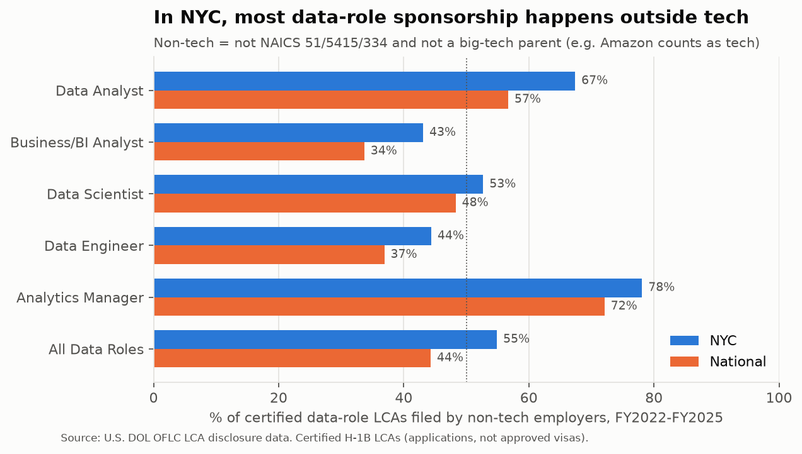
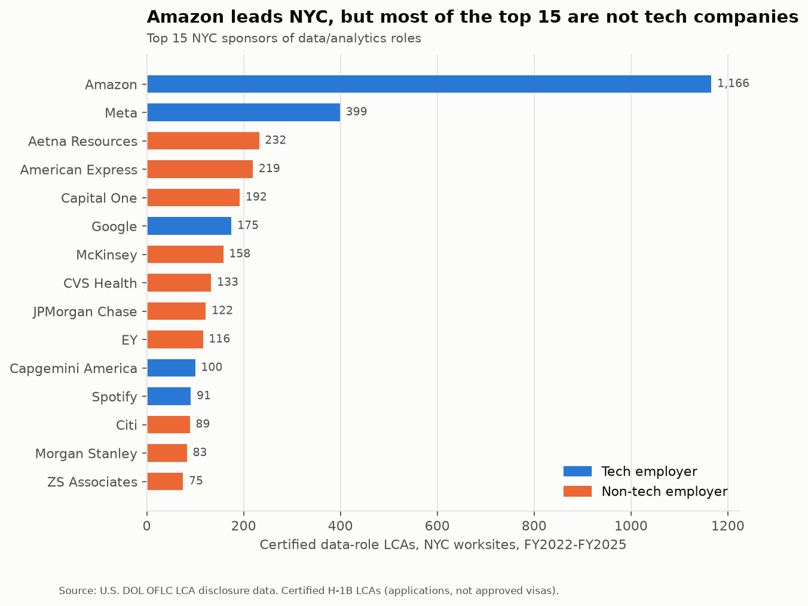
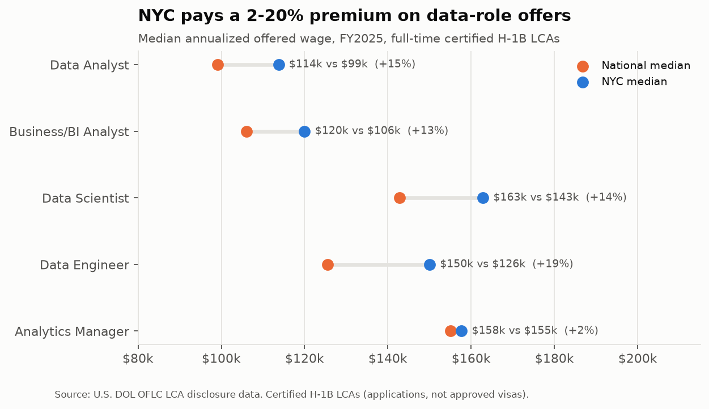
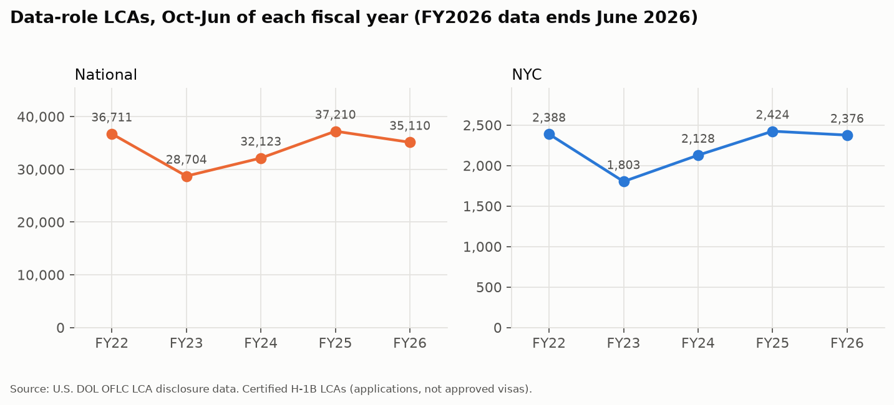
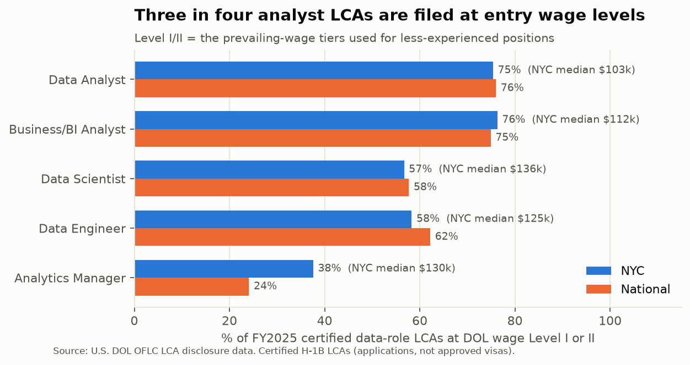

# H-1B Sponsorship Explorer: who sponsors data roles in NYC, what they pay, and how it's changing

An end-to-end analysis of **2.87 million** U.S. Department of Labor H-1B Labor
Condition Applications (FY2022 – FY2026 Q3). It runs from raw Excel files
through Parquet, DuckDB SQL, and a validated star schema to findings, with a
Power BI build kit.

**Question:** Which employers sponsor data/analytics roles, what do they pay, and how is that changing? The focus is New York City, with national comparisons.

## Key findings

| # | Finding | Number |
|---|---|---|
| 1 | **In NYC, most data-role sponsorship is outside tech.** Finance & insurance alone files 23% of NYC data-role LCAs (12% elsewhere). | **55%** of NYC data-role LCAs come from non-tech employers (44% nationally); **67%** for Data Analysts |
| 2 | **NYC offers a 13–20% premium** for analyst, scientist and engineer roles, but almost none for analytics managers. | FY2025 median offer, data engineer: **$150k NYC vs $126k national** |
| 3 | **Analyst roles are where sponsorship and entry level overlap most.** | **76%** of Data Analyst LCAs are filed at entry wage Levels I/II; the NYC median Level I/II offer is **$103k** |
| 4 | **Concentrated at the top, long tail below.** | Amazon = **10.8%** of NYC data LCAs, and the top 10 = 27%. But 2,464 employers sponsored in NYC, and 1,341 of them filed just one |
| 5 | **Hidden sponsors file every year:** Capital One (80% Level I/II), Morgan Stanley (94%), Goldman Sachs (85%), Mount Sinai (87%), Aetna, AmEx, CVS, Citi. | `outputs/tables/q5b_hidden_sponsors_nyc.csv` |
| 6 | **FY2026 so far is softer, but data roles are gaining share.** | Oct–Jun data LCAs **−5.6%** vs FY2025 (all LCAs −8.4%); data share at a 5-year high of **8.95%**; NYC median offer **+6.3%** to $150k |

Full write-up with every supporting number: **[docs/FINDINGS.md](docs/FINDINGS.md)**



<details><summary>More charts</summary>





</details>

## Read this before quoting any number: data caveats

1. **An LCA is not an H-1B visa, and not a hire.** Before filing an H-1B petition, an employer must get a certified LCA from the Department of Labor. Certification is close to automatic: only 0.56% of H-1B LCAs in this data were denied. Then: one person can be covered by several LCAs, many LCAs are never used (e.g. the worker isn't selected in the cap lottery or takes another job), and one LCA can list several positions. **Everything here measures employers' *willingness to sponsor*, not the number of people sponsored.**
2. **Wages are offered base salary**, the bottom of any posted range, annualized. No bonus or equity. That understates finance and big-tech pay.
3. **Role families come from rules on job titles** (spot-checked at ~97–98% precision on 100 sampled rows). Deliberate exclusions: ML engineers, quants, statistical programmers. See [DECISIONS.md §7](docs/DECISIONS.md).
4. **"Tech"** = NAICS 51 / 5415 / 334 **plus** big-tech parents (Amazon files under retail). Online retailers like Wayfair count as non-tech.
5. **NYC = the five boroughs**, primary worksite only. Jersey City is not included.
6. **FY2026 is partial** (Oct 2025 – Jun 2026). It is only ever compared like-for-like.
7. Wage level (I–IV) describes the job as the employer classified it, not the worker.

## What's in the repo

```
├── README.md                      ← you are here
├── requirements.txt               pinned Python packages
├── src/                           Python: run in order
│   ├── 01_download.py             download 17 DOL Excel files (~1.7 GB) to data/raw/
│   ├── 02_load.py                 Excel → Parquet → DuckDB table lca_raw; column inventory
│   ├── 03_clean.py                runs sql/00-03, then validation → docs/validation_report.md
│   ├── run_sql.py                 runs sql/analysis/*.sql → outputs/tables/*.csv
│   ├── 05_powerbi_export.py       star schema → outputs/powerbi/*.csv
│   └── 06_charts.py               PNG charts → outputs/charts/
├── sql/
│   ├── 00_ref_naics_sectors.sql   NAICS sector lookup
│   ├── 01_clean_base.sql          dedupe, types, fiscal year, NYC flag, wages + flags, SOC repair
│   ├── 02_clean_employers.sql     employer-name standardization (3 layers, logged)
│   ├── 03_clean_roles_final.sql   role families, parent roll-up, tech flag, final tables
│   └── analysis/q0 … q6b          one commented query per question
├── docs/
│   ├── FINDINGS.md                findings as interview answers, with numbers
│   ├── DECISIONS.md               every judgment call and why
│   ├── LEARNING_NOTES.md          study guide: techniques, file:line pointers, exercises
│   ├── DAX_MEASURES.md            ready-to-paste Power BI measures, explained
│   ├── POWERBI_BUILD_GUIDE.md     page-by-page build plan
│   ├── validation_report.md       generated: row counts, flags, coverage, spot-checks
│   └── column_inventory.md        generated: which columns each raw file had
├── outputs/
│   ├── tables/                    every analysis result as CSV
│   ├── charts/                    README charts
│   ├── powerbi/                   star schema CSVs (big fact table git-ignored)
│   └── employer_merge_log.csv     every employer-name merge, for auditing
├── data/                          git-ignored: raw/ (Excel), processed/ (Parquet), h1b.duckdb
└── notebooks/                     (empty: for your own exploration)
```

## Pipeline at a glance

| Step | Rows | What happens |
|---|---:|---|
| 17 raw Excel files | 2,865,776 | FY2022 Q1 – FY2026 Q3, 96–98 columns each |
| De-duplicated cases | 2,695,890 | One row per case (status from latest file, timing from first decision) |
| Certified H-1B | 2,415,525 | `lca_certified`, the analysis table |
| …data roles | 202,909 | 5 role families |
| …data roles in NYC | 13,144 | |

## How to reproduce

Requirements: Python 3.12, ~6 GB free disk, ~30 minutes (most of it reading Excel).

```bash
git clone <this repo> && cd h1b-sponsorship-explorer
```

```bash
python -m venv .venv && .venv/Scripts/activate
```
(on macOS/Linux: `source .venv/bin/activate`)

```bash
pip install -r requirements.txt
```

```bash
python src/01_download.py
```

```bash
python src/02_load.py
```

```bash
python src/03_clean.py
```

```bash
python src/run_sql.py "sql/analysis/*.sql" --csv
```

```bash
python src/05_powerbi_export.py
```

```bash
python src/06_charts.py
```

To explore interactively: `python -c "import duckdb; duckdb.connect('data/h1b.duckdb').sql('FROM lca_certified LIMIT 5').show()"`, or open `data/h1b.duckdb` in DBeaver or the DuckDB CLI.

**Source:** U.S. Department of Labor, Office of Foreign Labor Certification, [Performance Data](https://www.dol.gov/agencies/eta/foreign-labor/performance), LCA Programs (H-1B, H-1B1, E-3) disclosure files. Downloaded 2026-11-06.

**Stack:** Python (pandas, python-calamine, matplotlib) · DuckDB SQL · Parquet · Power BI (build guide).
